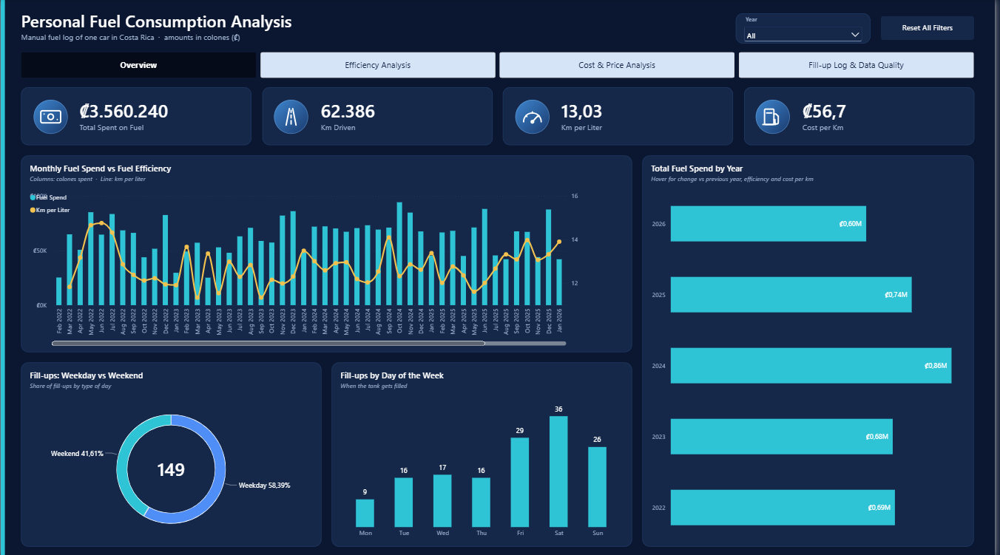
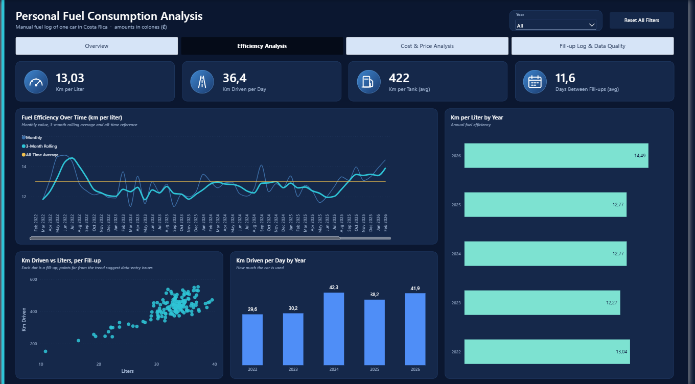
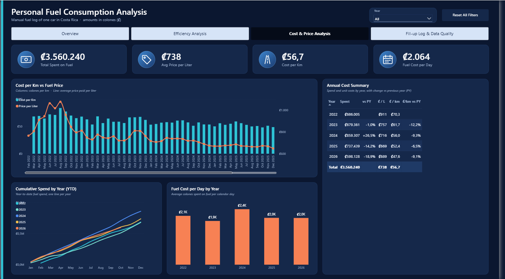

# Personal Fuel Consumption Analysis (Power BI)

*Part of my [Data Analyst Portfolio](https://github.com/FBaradin/Data-Analyst-Portfolio).*

An end-to-end Power BI project built on almost five years of my own fuel log: **149 fill-ups, 62,386 km and ₡3.56 million** spent on fuel between February 2022 and October 2026.

The report answers three questions:
- How efficient is the car, and is it changing over time?
- What does driving actually cost per km and per day, and what drives that cost?
- Can the manually collected data be trusted?

**[▶ Open the interactive report](https://app.powerbi.com/view?r=eyJrIjoiYTA2MDgzZDEtNDEwNi00ZmY0LTk2NTctZjY3NmM3NDJkZmZlIiwidCI6IjE3MDU2NzI2LWJjZWQtNDE5Ny1iOWZmLTdlZjc4YjM4ZjVjOCIsImMiOjZ9&pageName=overview)** (Power BI, no sign-in needed)

The whole project is saved as a **Power BI Project (`.pbip`)**, so the data model, DAX measures and report layout are plain text files under version control. Every change can be reviewed as a diff in this repository's history.



## Key insights

| Metric (Feb 2022 – Oct 2026) | Value |
|---|---|
| Fuel efficiency | **13.03 km/L** |
| Cost per km | **₡56.7** |
| Average price paid | **₡738 / L** |
| Distance driven per day | **36.4 km** |
| Fuel cost per day | **₡2,064** |
| Distance per tank | **422 km**, every **11.6 days** on average |

1. **Driving got 32% cheaper per km.** Cost per km fell from ₡70.3 in 2022 to ₡47.6 in 2026. Most of the drop comes from the fuel price (₡911/L on average in 2022 vs ₡689/L in 2026). 2026 is also the most efficient year so far, at 14.5 km/L.
2. **I drive about 40% more than in 2022**, around 42 km/day in 2024 and 2026 versus 29.6 in 2022. Annual spend in the full years 2022–2025 still stayed between ₡679k and ₡859k, because cheaper fuel offset the extra km.
3. **Efficiency dipped in 2023** (12.3 km/L), with the three worst months of the series (Mar, May and Sep 2023, all around 11.3–11.5 km/L). The best month is Sep 2026 at 15.6 km/L.
   - In 2022–2023 I moved between areas. The mid-2022 peak (14.8 km/L in June) matches a period living in a very flat region.
   - Since 2024 I've lived in the same area, so the 2026 improvement isn't explained by a move.
4. **Fill-ups happen mostly on weekends.** 42% of fill-ups fall on Saturday or Sunday, although weekends are only 29% of days. Saturday is the most common day (36 fill-ups), Monday the least (9).
5. **Tanks last longer than I planned.** I aim to refill every ~300 km, but the real average is 422 km per tank.

*2026 covers January to October only.*

## Report pages

| Page | What it shows |
|---|---|
| **Overview** | Headline KPIs, monthly spend vs efficiency, spend by year, fill-up habits (weekday vs weekend, day of week) |
| **Efficiency Analysis** | Km per liter over time with a 3-month rolling average and all-time reference line, efficiency by year, km driven vs liters per fill-up (scatter), km per day by year |
| **Cost & Price Analysis** | Cost per km vs fuel price, annual cost summary with year-over-year change, cumulative YTD spend by year, fuel cost per day by year |
| **Fill-up Log & Data Quality** | Full fill-up log and the validation notes behind the numbers |

All pages share a synced **Year** slicer, a **Reset All Filters** button and tab-style page navigation.

| Efficiency | Cost & Price |
|---|---|
|  |  |

## How it was built

### 1. Data preparation (Power Query)
- The source is an Excel table (`data/fuel-log.xlsx`), loaded through a **`FilePath` parameter** so the source can be repointed (e.g. to OneDrive) by changing one value.
- **Layered queries**:
  - `Refuels_Staging` holds the cleaning pipeline and isn't loaded.
  - `Refuels` (loaded) and `QA_Checks` (validation only) both reference it.
- Columns renamed to English; **Fixed Decimal** type for currency columns.
- **Km driven** and **days between fill-ups** are rebuilt from the odometer and dates. Since Power Query has no "previous row" function, this uses a **self-merge on an index** (left outer join). They are then validated against the values originally calculated in Excel.
- Ratios that were pre-calculated in Excel (km/L, ₡/km) are dropped and rebuilt as DAX measures.

### 2. Data model
- **Star schema**: `Refuels` fact table plus a `Date` dimension.
  - `Date` is a DAX `CALENDAR` table covering full years, **marked as date table**.
  - Its month and weekday columns are sorted by numeric keys.
- One-to-many, single-direction relationship `Date[Date] → Refuels[Date]`. The fact table's date is hidden so every visual filters through the dimension.
- Auto date/time is turned off, and default summarization is set per column (e.g. odometer and price are never summed).

### 3. DAX
25 explicit measures in a dedicated `_Measures` table, grouped in display folders and documented with descriptions:
- **Ratios are ratios of sums**, never averages of row-level ratios. For example, `Km per Liter = DIVIDE([Total Km], [Liters Consumed])`, and `Avg Price per Liter` is weighted by liters.
- **`CALCULATE`** excludes the first fill-up from km-based measures. It has no previous odometer reading, so its liters can't be paired with km (fill-to-fill method).
- **Semi-additive** odometer measure (`LASTNONBLANKVALUE`).
- **Time intelligence**: `TOTALYTD`, `SAMEPERIODLASTYEAR`, year-over-year %, and a 3-month rolling efficiency (`DATESINPERIOD`). Results return blank after the last fill-up, so charts don't show flat "future" values.

### 4. Report design
- Custom dark theme (`FuelDark.json`) and custom SVG icons.
- Consistent 4-KPI header and grid layout on every page.

## Data quality

The checks and decisions are documented in [docs/data-quality.md](docs/data-quality.md):
- Recalculated km and days match the original Excel values on all 148 comparable rows.
- 3 fill-ups have amounts that don't match liters × price (likely typos in liters). **Amount is treated as the source of truth**, because it's what was actually paid.
- A trailing-space variant of the fuel type (`"Súper "`) was found through column profiling and trimmed.

## Repository structure

```
fuel-consumption-powerbi/
├── data/fuel-log.xlsx                  Source data (manual fuel log)
├── docs/
│   ├── data-quality.md                 Validation checks and known limitations
│   └── screenshots/                    Report screenshots
└── powerbi/
    ├── Fuel-Consumption.pbip           Open this file in Power BI Desktop
    ├── Fuel-Consumption.SemanticModel/ Data model as TMDL (tables, measures, relationships)
    └── Fuel-Consumption.Report/        Report pages, visuals, theme and icons as JSON
```

**To open the report:**
1. Clone the repository and open `powerbi/Fuel-Consumption.pbip` in Power BI Desktop.
2. Go to **Transform data → Edit parameters** and point `FilePath` to your local copy of `data/fuel-log.xlsx`.
3. Click **Refresh**.

## Tools and skills

**Power BI Desktop** (Power Query / M, DAX, data modeling, report design) · **Excel** · **Git and GitHub** (feature branch, commits with review of TMDL/JSON diffs).

Mapped to the PL-300 exam areas:
- **Prepare the data:** parameters, data profiling, data types, merges, reference vs duplicate queries, disabling query load.
- **Model the data:** star schema, date table, relationships and cardinality, summarization, explicit measures, `CALCULATE`, time intelligence, semi-additive measures.
- **Visualize and analyze:** themes, page navigation, synced slicers, combo/scatter/table visuals, rolling averages, reference lines.

## Possible next steps
- Add the maintenance log (second sheet in the workbook) to analyze total cost of ownership per km.
- Publish to the Power BI Service with scheduled refresh from OneDrive.

## Contact Information

- **Email:** [f.baradin@gmail.com](mailto:f.baradin@gmail.com)
- **LinkedIn:** [Francisco Baradín](https://www.linkedin.com/in/franciscobaradin13256664/)
